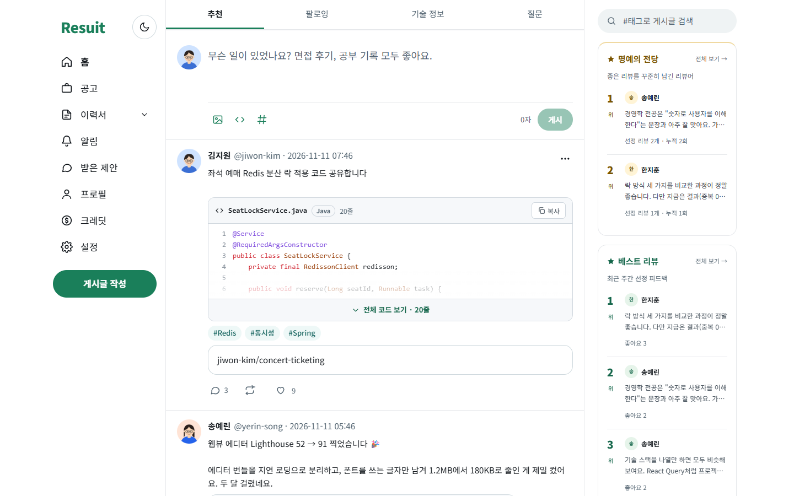
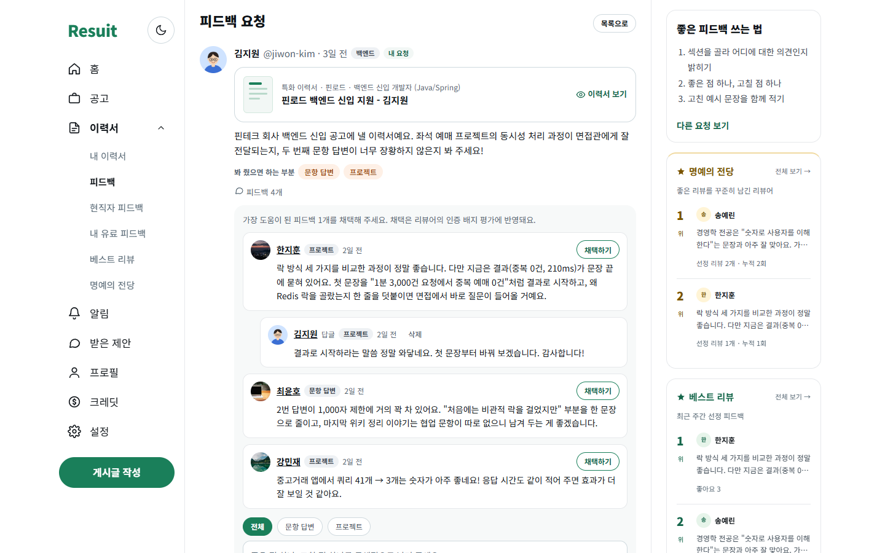
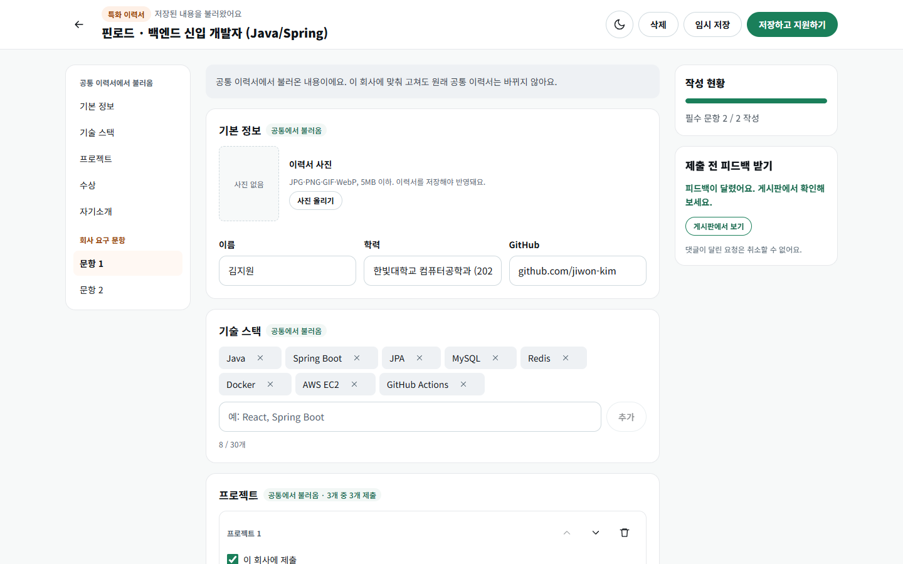
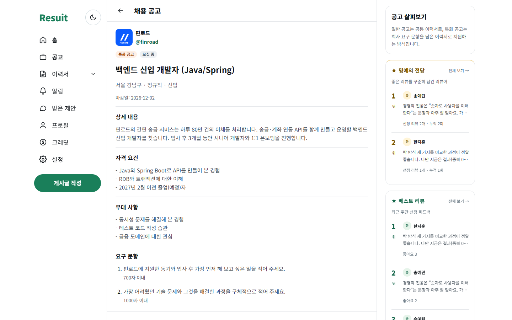
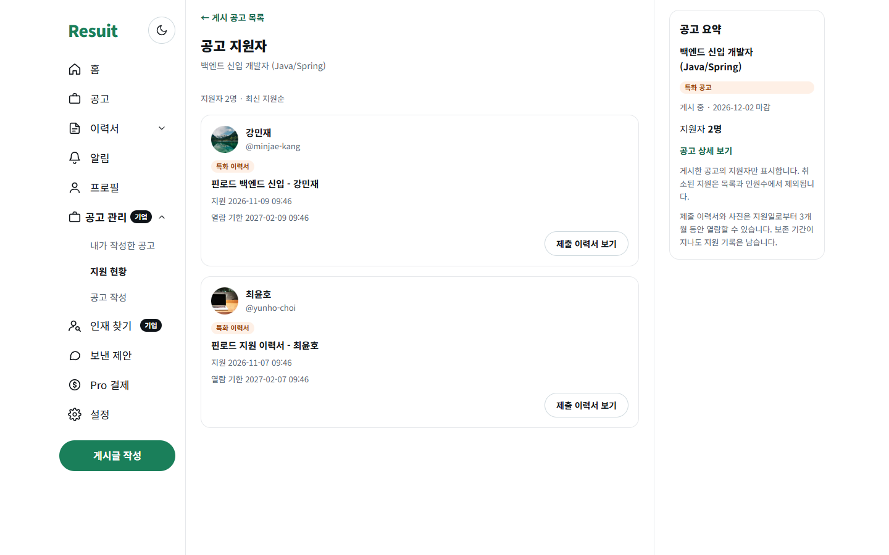
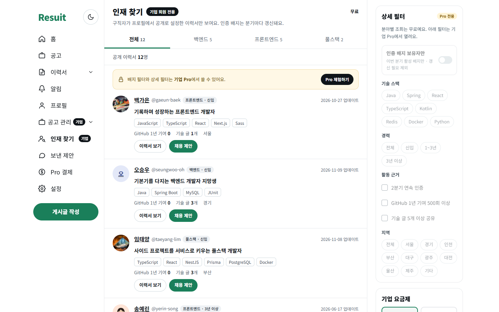
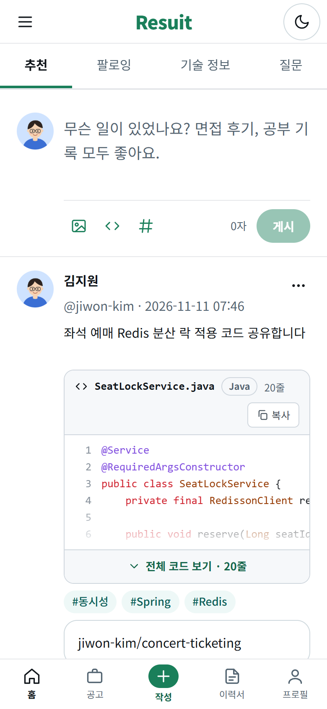
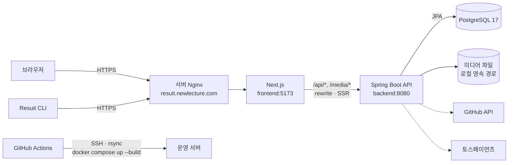

# Resuit (레쥬잇)

> 개발자 특화 SNS 및 채용 연계 웹 플랫폼

개발자가 짧은 생각과 기술 지식을 공유하고, GitHub 활동을 소개하며, 이력서 피드백을 주고받는 서비스입니다.
기업은 같은 서비스 안에서 채용 공고를 올리고, 지원서를 받고, 활동 기록을 바탕으로 인재를 찾습니다.

- **서비스 주소**: https://resuit.newlecture.com
- **개발 기간**: 2026.10.28 ~ 2026.11.11
- **팀**: 임재혁, 이상호, 이동준, 백승주, 김종수

<br>

## 목차

1. [기획 배경](#기획-배경)
2. [화면 미리보기](#화면-미리보기)
3. [주요 기능](#주요-기능)
4. [사용자 유형과 권한](#사용자-유형과-권한)
5. [기술 스택](#기술-스택)
6. [시스템 아키텍처](#시스템-아키텍처)
7. [팀 구성과 역할](#팀-구성과-역할)
8. [폴더 구조](#폴더-구조)
9. [로컬 실행](#로컬-실행)
10. [DB 마이그레이션](#db-마이그레이션)
11. [배포](#배포)
12. [Resuit CLI](#resuit-cli)
13. [협업 방식](#협업-방식)
14. [문서](#문서)

<br>

## 기획 배경

개발자의 일상적인 생각, 기술 지식, GitHub 활동, 이력서 피드백이 여러 서비스에 흩어져 있다는 문제에서 출발했습니다.
이를 하나의 서비스에 기록하고 공유할 수 있게 하고, 기업 사용자에게는 인재 탐색과 채용 공고·지원서 접수 기능을 제공해 **개발 활동과 채용을 연결**하는 것이 목표입니다.

개발 목표

1. 사용자 권한(일반·기업)에 따른 웹 서비스 구현
2. 피드·기술 글·이력서 피드백 기능 구축
3. GitHub API 연동
4. 배지, 인재 탐색, 채용 지원 기능 구현
5. 자동 배포 및 검증 환경 마련

<br>

## 화면 미리보기

> 시연용 데이터(`database/demo/demo-seed.sql`)를 넣은 로컬 환경에서 캡처한 화면입니다. 회사와 사람은 모두 가상입니다.

<table>
  <tr>
    <td width="50%"></td>
    <td width="50%"></td>
  </tr>
  <tr>
    <td align="center"><b>홈 피드</b><br>코드 블록·해시태그·레포 링크, 명예의 전당과 베스트 리뷰</td>
    <td align="center"><b>이력서 피드백</b><br>섹션별 피드백과 답글, 채택</td>
  </tr>
  <tr>
    <td></td>
    <td></td>
  </tr>
  <tr>
    <td align="center"><b>특화 이력서 작성</b><br>공통 이력서를 불러와 회사 문항에 답하고, 제출 전에 피드백 요청</td>
    <td align="center"><b>채용 공고 상세</b><br>특화 공고의 상세 내용과 요구 문항</td>
  </tr>
  <tr>
    <td></td>
    <td></td>
  </tr>
  <tr>
    <td align="center"><b>기업 · 지원자 목록</b><br>공고별 지원자와 제출 이력서 (지원 후 3개월 열람)</td>
    <td align="center"><b>기업 · 인재 탐색</b><br>공개 이력서를 분야별로 보고 채용 제안, Pro 상세 필터</td>
  </tr>
</table>

<p align="center">
  <br>
  <b>모바일</b> · 상단 바와 하단 바로가기 메뉴
</p>

<br>

## 주요 기능

### 피드 · SNS
- 추천 / 팔로잉 / 기술 정보 / 질문 탭으로 나뉜 피드
- 게시글·댓글·답글 작성, 좋아요, 팔로우
- 사진·영상 첨부, 줄 번호와 구문 강조가 있는 코드 블록
- 기술 정보 글의 기술 태그(최대 3개), 모든 글의 해시태그(최대 10개)와 해시태그 검색
- 어느 화면에서나 여는 게시글 작성 모달, 맨 위로 이동하며 새 글을 불러오는 버튼

### 프로필 · 외부 연동
- 공개 프로필, 활동 탭(게시글·남긴 피드백·기술 정보), 대표 이력서 고정, 대표 배지 선택
- GitHub 연동: 기여 잔디, 공개 저장소 목록, 대표 레포 선택 (매일 기여 통계 갱신)
- 블로그 RSS 연동: 검증 코드로 소유권을 확인하고 새 글을 주기적으로 수집
- Google · GitHub · 네이버 소셜 로그인과 아이디·비밀번호 로그인

### 이력서 · 피드백 · 배지
- **공통 이력서**: 기본 양식의 이력서. 분야(프론트엔드·백엔드·풀스택)를 고르고 프로필에 공개할 수 있습니다.
- **특화 이력서**: 공고별 추가 문항에 답하는 지원용 이력서. 공통 이력서를 복사하거나 빈 상태로 시작합니다.
- **피드백 게시판**: 이력서를 올려 섹션별 피드백을 받고, 가장 도움 된 피드백을 채택합니다.
- **베스트 리뷰 · 명예의 전당**: 좋아요를 많이 받은 리뷰를 주간·월간으로 선정합니다.
- **리뷰어 배지**: 채택 수, 서로 다른 요청자 수, 베스트 리뷰 선정을 분기마다 평가해 리뷰어·우수 리뷰어 배지를 줍니다.

### 유료 피드백 · 크레딧
- 회사 이메일로 인증한 **현직자**에게 크레딧을 내고 이력서 피드백을 받습니다. 현직자 목록은 직무(백엔드·프론트엔드·풀스택)별로 나눠 볼 수 있습니다.
- 크레딧 충전(토스페이 테스트 결제, 1크레딧 = 100원)과 사용·적립 내역
- 피드백으로 적립한 크레딧의 현금 환전(수수료 20%, 1크레딧 = 80원)

### 채용 공고 · 지원
- 기업 회원의 공고 작성·임시저장·수정·마감, 지원자 목록과 제출 이력서 열람
- **일반 공고**는 공통 이력서로, **특화 공고**는 그 공고의 특화 이력서로 지원
- 지원 시 이력서 본문과 사진을 스냅샷으로 보존하고, 3개월이 지나면 열람을 막고 정리합니다.

### 기업 인재 탐색
- 공개 이력서를 분야별로 조회하고 채용 제안을 보냅니다. 받은 회원은 승낙·거절로 응답합니다.
- **기업 Pro**(14일 체험, 1개월·3개월 이용권): 인증 배지, 연속 인증, 기술 스택, 경력, GitHub 기여, 기술 글 수, 지역 필터

### 알림
- 내 글의 댓글·답글, 이력서 피드백·채택, 유료 피드백 요청·답변, 채용 제안·응답, 공고 지원을 알려 줍니다.
- 왼쪽 메뉴에 안 읽은 알림 수를 표시하고, 누르면 해당 화면으로 이동합니다.

### 그 밖에
- **모바일 화면**: 상단 바, 서랍 메뉴, 하단 바로가기 메뉴
- **Resuit CLI**: 터미널에서 로그인하고 게시글·질문·기술 글·코드 글을 올리는 명령줄 도구 ([아래](#resuit-cli) 참고)

<br>

## 사용자 유형과 권한

| 유형 | 할 수 있는 일 |
| --- | --- |
| 비로그인 방문자 | 공개 피드·공고·프로필·베스트 리뷰·명예의 전당 조회 |
| 일반 회원 (`USER`) | 피드·댓글·좋아요·팔로우, 이력서, 피드백, 채용 지원, 유료 피드백, 배지 |
| 기업 회원 (`COMPANY`) | 공고 관리, 지원자 조회, 기본 인재 탐색, 채용 제안 |
| 기업 Pro | 기업 회원 기능 + 인재 탐색 상세 필터 |

- 권한은 `users.role` 문자열(`USER`, `COMPANY`)로 관리합니다. 기업 Pro는 별도 역할이 아니라 `company_plan_periods`의 유효한 체험·이용 기간으로 판정합니다.
- 모든 권한은 화면의 버튼 노출이 아니라 **백엔드 API에서** 검사합니다. 작성자 본인, 공고 소유 기업, 공개 범위, 요청 상태 같은 조건도 서비스 계층에서 확인합니다.

<br>

## 기술 스택

| 영역 | 기술 |
| --- | --- |
| Frontend | Next.js 16 (App Router), React 19, JavaScript, CSS 디자인 토큰 |
| Backend | Java 21, Spring Boot 4.1, Spring MVC, Spring Security, Spring Data JPA (Hibernate) |
| Database | PostgreSQL 17 |
| 인증 | 서버 세션(`JSESSIONID`) + CSRF, OAuth2 소셜 로그인 (Google · GitHub · 네이버) |
| 외부 연동 | GitHub REST · GraphQL API, 블로그 RSS, 토스페이먼츠(테스트 결제) |
| Infra | Docker, Docker Compose, Nginx |
| CI/CD | GitHub Actions (SSH · rsync 배포) |
| CLI | Node.js 20+, TypeScript |
| 협업 | GitHub Issues · Projects(칸반) · Pull Request |

<br>

## 시스템 아키텍처



- 첫 화면은 Next.js 서버에서 HTML로 렌더링하고, 이후 페이지 이동은 전체 새로고침 없이 처리합니다.
- 브라우저의 `/api/*`, `/media/*` 요청은 Next.js rewrite로 백엔드에 전달되어, 프론트와 API가 같은 출처를 씁니다.
- 운영 환경은 프론트만 `127.0.0.1:3003`으로 열고, 백엔드와 DB는 Compose 내부 네트워크에만 둡니다.
- 백엔드는 `controller → service(인터페이스) → service.impl → repository → entity` 계층을 따르며, 컨트롤러는 엔티티 대신 DTO(`record`)를 반환합니다.

<br>

## 팀 구성과 역할

| 이름 | GitHub | 담당 기능 |
| --- | --- | --- |
| 임재혁 | [@ChungGyeon](https://github.com/ChungGyeon) | 게시글·피드(타임라인, 댓글, 좋아요, 탭별 피드, 미디어, 코드 블록), 채용 공고(목록·상세, 지원·취소, 등록·초안 저장, 문항 관리), 회원가입·로그인 화면, 비로그인 접근 제한, 기술 태그·해시태그, 최상단 게시글 작성 영역, Resuit CLI, 운영 배포 |
| 김종수 | [@ggwg1121](https://github.com/ggwg1121) | 공통·특화 이력서, 이력서 피드백(게시판, 요청·취소, 미리보기, 댓글, 채택), 특화 이력서 제출 전 피드백 요청 |
| 이상호 | [@DavidLee534](https://github.com/DavidLee534) | 프로필(조회·수정, 위젯, 경력, 활동 탭, 대표 이력서), GitHub 동기화, 블로그 RSS 연동, 현직자 인증 상태·배지 표시, 기업 이메일 인증 취소, 피드백 게시판 상세 화면 |
| 이동준 | [@dongjun1580](https://github.com/dongjun1580) | 기업 이메일 인증, 베스트 리뷰·명예의 전당, 소셜 로그인, 비로그인 접근 제한 |
| 백승주 | [@backsjj-bit](https://github.com/backsjj-bit) | 유료 피드백(현직자, 크레딧 충전·환전, 현직자 직무), 기업 인재 탐색(Pro 필터, 이용권 결제, 채용 제안), 기업 회원 가입 분리, 이력서 사진 업로드, 알림, 반응형 화면, 게시글 작성 모달·맨 위로 버튼, 프론트엔드 Next.js 전환 |

<br>

## 폴더 구조

```
Resuit_Prj/
├─ frontend/                 Next.js 앱
│  └─ src/
│     ├─ app/                라우트와 metadata만 둔다. (service)/ 는 3단 레이아웃 페이지 묶음
│     ├─ views/              화면 컴포넌트 ('use client')
│     ├─ components/         layout · common · 도메인별 컴포넌트
│     ├─ services/           API 호출 함수 (authenticatedFetch로 세션·CSRF 처리)
│     ├─ context/            로그인·테마 등 공유 상태
│     └─ styles/             tokens.css(디자인 토큰), global.css
├─ backend/resuit/           Spring Boot 앱
│  └─ src/main/java/com/newlecture/resuit/
│     ├─ controller/  service/  service/impl/  repository/  entity/  dto/
│     ├─ config/             보안, OAuth, 세션, 미디어 설정
│     └─ scheduler/          베스트 리뷰 선정, GitHub 통계, 제출 이력서 정리 등 정기 작업
├─ cli/                      Resuit CLI (TypeScript)
├─ database/
│  ├─ migrations/            번호순 마이그레이션 SQL (001_ ~)
│  ├─ local/  demo/          로컬·시연용 데이터 SQL
├─ docs/                     설계 문서, API 문서, 수동 마이그레이션 SQL, ERD
├─ nginx/                    Nginx 설정 (개발용, 운영 서버용)
├─ scripts/                  로컬 DB 마이그레이션, 개별 실행 스크립트
├─ compose.yml               공통 Compose 구성
├─ compose.override.yml      개발 모드 (소스 마운트, 핫 리로드) — 자동 병합
├─ compose.prod.yml          운영 모드 — 배포 시 명시적으로 지정
└─ AGENTS.md                 레이아웃·디자인·API·DTO 개발 규칙
```

<br>

## 로컬 실행

### 준비

- Docker, Docker Compose
- (개별 실행 시) Node.js 22, JDK 21

### 1. 환경 변수

```bash
cp .env.example .env
```

`.env`에 DB 접속 정보와 필요한 키를 입력합니다. 실제 비밀번호와 키는 `.env`에만 두고 Git에 올리지 않습니다.

| 변수 | 용도 |
| --- | --- |
| `POSTGRES_DB`, `POSTGRES_USER`, `POSTGRES_PASSWORD`, `POSTGRES_PORT` | DB 접속 정보, 호스트에 여는 DB 포트 |
| `RESUIT_AUTH_PUBLIC_BASE_URL` | 브라우저로 여는 주소. OAuth 콜백 주소의 기준 |
| `GOOGLE_*`, `GITHUB_*`, `NAVER_*` `_CLIENT_ID` / `_CLIENT_SECRET` | 소셜 로그인 (설정한 제공자만 활성화) |
| `INTEGRATION_TOKEN_SECRET` | GitHub 연동 토큰 암호화 키 (32자 이상) |
| `TOSS_CLIENT_KEY`, `TOSS_SECRET_KEY` | 크레딧·기업 Pro 테스트 결제 |
| `SPRING_MAIL_*`, `VERIFICATION_MAIL_FROM` | 메일 발송 (선택) |

### 2. 전체 실행 (Docker Compose 개발 모드)

```bash
docker compose up -d --build
```

`compose.override.yml`이 자동으로 병합되어 소스 폴더를 컨테이너에 마운트합니다.

| 서비스 | 주소 |
| --- | --- |
| Nginx | http://localhost |
| 프론트엔드 | http://localhost:3003 |
| 백엔드 API | http://localhost:8080 |
| PostgreSQL | `127.0.0.1:${POSTGRES_PORT}` |

- 프론트엔드는 저장하면 바로 반영됩니다(핫 리로드).
- 백엔드는 저장 후 `docker compose restart backend`로 다시 컴파일합니다.
- 다른 프로그램이 80번 포트를 쓰고 있으면 프론트엔드 주소(3003)로 접속합니다.
- 의존성이 바뀌었으면 `docker compose up -d --build -V`로 `node_modules` 볼륨을 새로 만듭니다.

### 3. DB만 띄우고 프론트·백엔드를 따로 실행

```bash
docker compose up -d --build db
bash scripts/migrate-local-db.sh   # 기존 DB에 마이그레이션 적용
bash scripts/dev-backend.sh        # 터미널 1
bash scripts/dev-frontend.sh       # 터미널 2
```

기본 주소는 프론트엔드 http://localhost:5174, 백엔드 http://localhost:8081이며, `.env`의 `RESUIT_FRONTEND_PORT`, `RESUIT_BACKEND_PORT`로 바꿀 수 있습니다.
DB가 완전히 비어 있다면 먼저 [개인 DB 초기화 안내](docs/api/local-development.md)를 따릅니다. 공용 DB에는 초기화 절차를 실행하지 않습니다.

<br>

## DB 마이그레이션

Flyway·Liquibase 없이 SQL 파일로 스키마 변경을 관리합니다.

- 변경 SQL은 `database/migrations/`에 번호순(`001_` ~)으로 추가합니다. 다시 실행해도 안전하게(`IF NOT EXISTS` 등) 작성합니다.
- 로컬 DB 적용:

  ```bash
  bash scripts/migrate-local-db.sh --list   # 실행 목록만 확인
  bash scripts/migrate-local-db.sh          # 실제 적용 (.env의 POSTGRES_HOST가 localhost일 때만)
  ```

- 운영 DB는 스키마를 자동 변경하지 않고 `validate`로 검증만 합니다. 새 SQL은 배포 전에 운영 DB에 먼저 적용해야 합니다.
- 테이블과 관계는 [데이터베이스 설계](docs/database-design.md)에서 관리합니다.

<br>

## 배포

```
dev 브랜치 push → GitHub Actions → SSH 접속 → rsync로 소스 전송(.env 제외)
→ 운영 서버에서 docker compose 빌드·기동 → 컨테이너 상태 확인
```

- 워크플로: [`.github/workflows/deploy.yml`](.github/workflows/deploy.yml) (`dev` push 또는 수동 실행)
- 운영 실행 명령 (`compose.override.yml`을 읽지 않도록 파일을 명시합니다):

  ```bash
  docker compose --env-file .env -f compose.yml -f compose.prod.yml up -d --build --remove-orphans
  ```

- 운영 서버의 Nginx가 `resuit.newlecture.com`을 `127.0.0.1:3003`(프론트엔드)으로 전달합니다. 사이트 설정 예시는 [`nginx/resuit.newlecture.com.conf`](nginx/resuit.newlecture.com.conf)에 있습니다.
- 운영 `.env`에는 `RESUIT_AUTH_PUBLIC_BASE_URL`(실제 접속 주소)과 `INTEGRATION_TOKEN_SECRET`을 반드시 설정합니다.
- 업로드 이미지와 제출 이력서 스냅샷은 `backend/resuit/src/main/media/`를 컨테이너의 `/var/lib/resuit/media`에 마운트해 유지합니다. 이 경로는 rsync 전송·삭제 대상과 이미지 빌드에서 제외됩니다.

<br>

## Resuit CLI

터미널에서 Resuit에 로그인하고 글을 올리는 명령줄 도구입니다.

```bash
cd cli
npm install && npm run build && npm link
export RESUIT_API_URL=https://resuit.newlecture.com   # 미설정 시 http://localhost:8080

resuit login
resuit post "Next.js에서 배운 점"
resuit ask "Spring Security 세션이 궁금해요" --hashtag Java,Spring
resuit tech "React 상태 관리 비교" --tech React,TypeScript
resuit code "Redis 캐싱 적용기" --repo owner/project --file cache.ts --language typescript --code "const value = await cache.get(key);"
```

자세한 사용법은 [cli/README.md](cli/README.md)를 참고합니다.

<br>

## 협업 방식

- **Git Flow**: `main` · `dev`를 두고, 기능은 `feature/*`, 버그 수정은 `bugfix/*`, 긴급 수정은 `hotfix/*` 브랜치에서 작업합니다.
- **칸반**: GitHub Projects 카드 기준으로 브랜치를 만들고, `Todo → In Progress → Done`으로 진행합니다.
- **PR**: 작업은 `dev`로 PR을 올리고, 팀원 확인 후 머지합니다. PR 설명에 작업 내용, 변경 파일, 확인 결과를 남깁니다.
- **개발 규칙**: 화면 레이아웃(3단 구조 유지), 디자인 토큰, API 설계, DTO 규칙은 [AGENTS.md](AGENTS.md)를 따릅니다.

<br>

## 문서

| 문서 | 내용 |
| --- | --- |
| [docs/database-design.md](docs/database-design.md) | ERD, 테이블 명세, 인덱스와 동시성 규칙 |
| [docs/erdcloud/](docs/erdcloud/) | ERDCloud 가져오기용 SQL |
| [docs/api/local-development.md](docs/api/local-development.md) | 개인 DB 초기화와 개별 실행 |
| [docs/api/social-login.md](docs/api/social-login.md) | 소셜 로그인 앱 등록 |
| [docs/api/login-access-policy.md](docs/api/login-access-policy.md) | 비로그인 접근 범위 |
| [docs/api/company-verification.md](docs/api/company-verification.md) | 기업 이메일 인증 API |
| [docs/api/review-likes.md](docs/api/review-likes.md) | 베스트 리뷰·리뷰 좋아요 API |
| [docs/api/job-drafts.md](docs/api/job-drafts.md) | 공고 임시저장 API |
| [docs/profile-api.md](docs/profile-api.md) | 프로필 API |
| [docs/badge-renewal.md](docs/badge-renewal.md) | 리뷰어 배지 분기 갱신 규칙 |
| [cli/README.md](cli/README.md) | Resuit CLI 사용법 |
