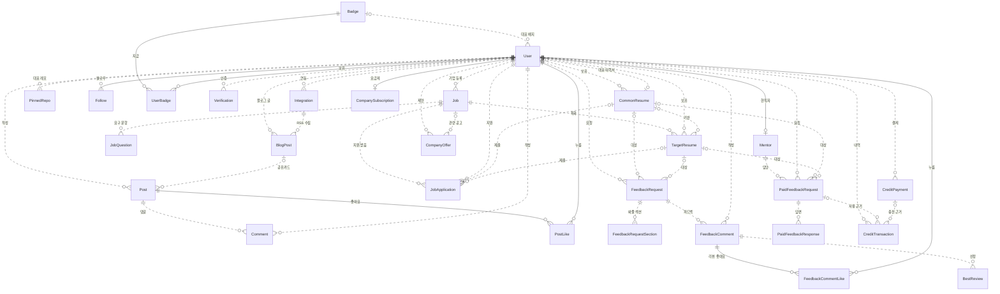
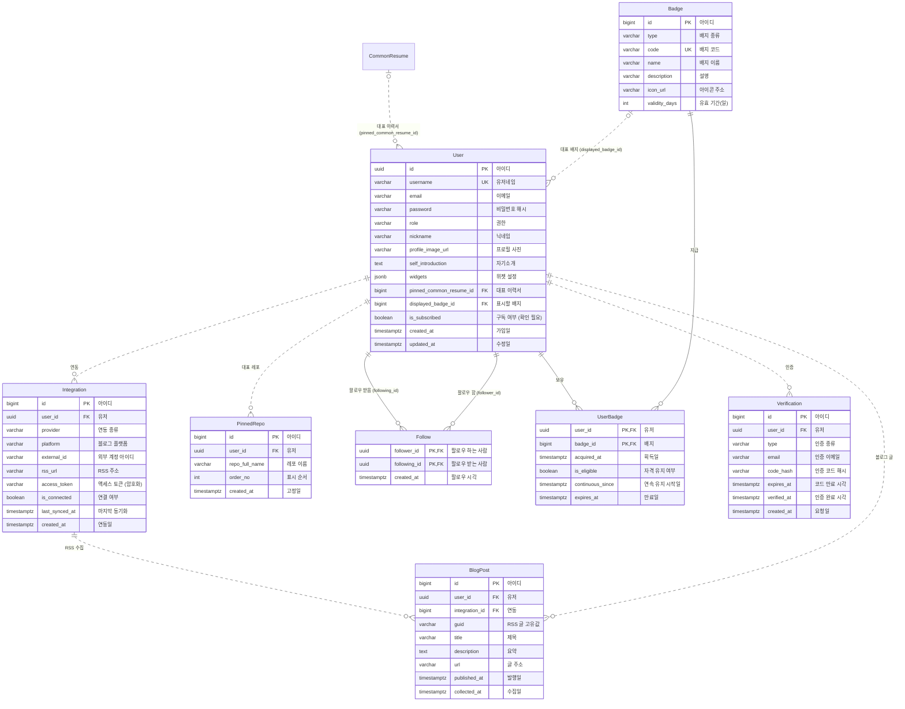
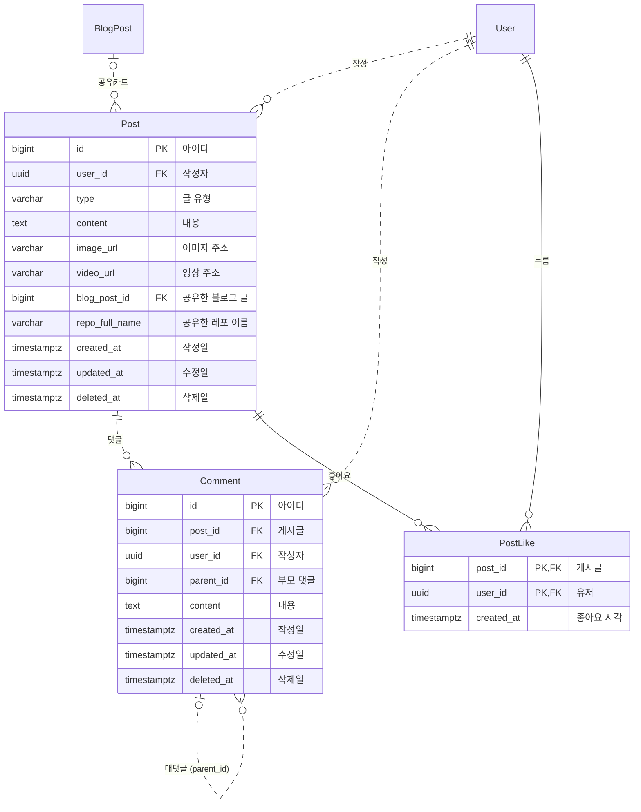
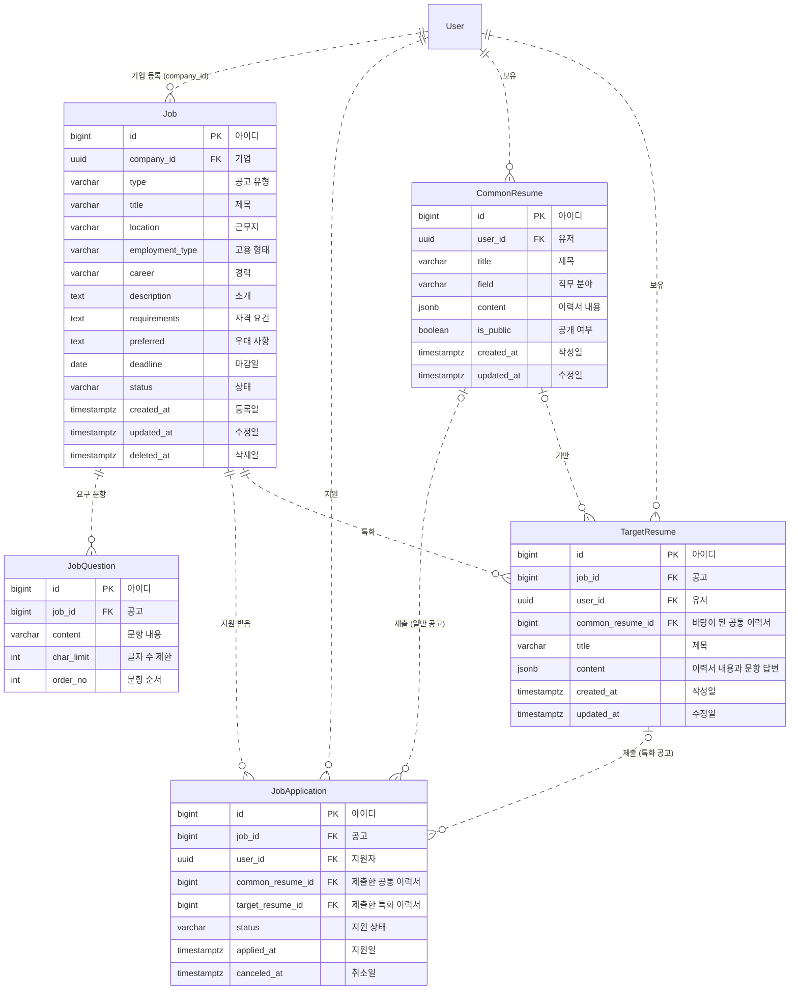
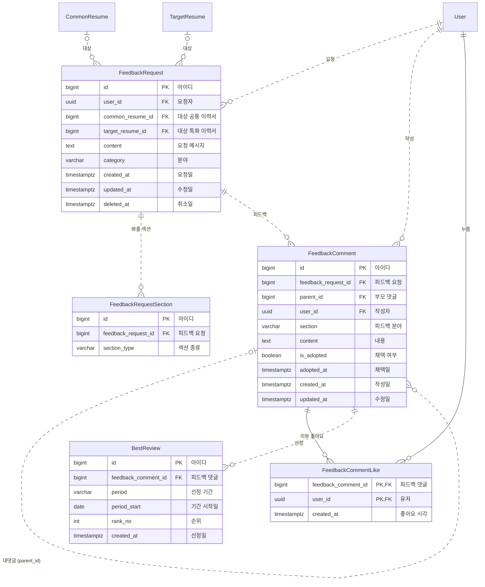
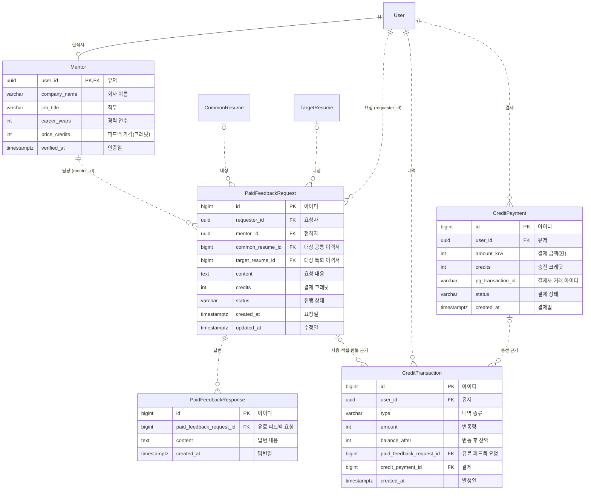
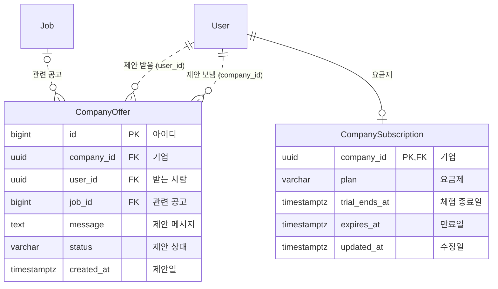

# Resuit 데이터베이스 설계

기준: 2026-11-03 `dev` (`0ff7695`, 엔티티 전체 구현 포함), [WBS](https://docs.google.com/spreadsheets/d/1IuCOi4WiGdTjOSWlioKDcJH4hhs4GN47pqmDBcK07A4/edit?gid=0#gid=0). 대상 DB는 PostgreSQL 17이다. 이 문서는 구현 전에 팀이 합의하는 데이터 계약이다. 실제 테이블은 Spring Boot 실행 시 JPA 엔티티를 기준으로 생성·갱신한다(`ddl-auto: update`). 엔티티를 만들거나 고칠 때 이 문서를 먼저 맞춘다.

## 1. 범위와 결정

| 영역 | 이번 설계에 포함 | 결정 |
| --- | --- | --- |
| 회원·프로필 | 내 프로필·사용자 프로필 조회, 프로필 수정, 위젯 설정, 대표 이력서 고정, GitHub 잔디·대표 레포, 최근 블로그 글, GitHub·블로그 연동과 해제(5.1~5.17), 팔로우·언팔, 배지, 기업 이메일 인증·현직자 인증 | 일반 회원·기업 회원·관리자는 모두 `users` 한 테이블에 두고 `role`로 구분한다. 프로필 주소는 고유한 `username`을 쓴다. GitHub 잔디와 전체 레포 목록은 GitHub API로 그때그때 가져오고 저장하지 않는다. 사용자가 고른 대표 레포(최대 3개)와 RSS로 수집한 블로그 글만 저장한다. 위젯 설정은 `users.widgets`에 둔다. 인증 코드는 해시로만 저장한다. |
| 게시글 | 타임라인·피드 탭 조회, 게시글 작성·수정·삭제·상세, 댓글 작성·수정·삭제·조회, 좋아요·취소, 사진·영상 업로드(1.1~1.17) | 글 유형 태그는 `posts.type` 하나로 표현하고 기술 정보·질문 탭은 이 값으로 거른다. 팔로잉 탭은 `follows`를 기준으로 거른다. 블로그 공유카드는 수집한 블로그 글을, 레포 공유카드는 레포 이름을 가리킨다. 게시글과 댓글은 삭제 시각만 기록한다. 사진·영상은 파일 저장소에 두고 주소만 저장한다. 코드 블록은 본문 안에 그대로 쓴다. |
| 공고·이력서 | 공고 목록·상세, 일반·특화 공고 지원과 취소, 공고 작성·임시 저장·수정·삭제, 요구 문항(2.1~2.12), 공통·특화 이력서 목록·생성·수정·삭제·상세(3.1, 3.4~3.13) | 공고는 `GENERAL`(일반), `SPECIAL`(특화) 두 종류다. 임시 저장은 `DRAFT` 상태로 저장한다. 일반 공고는 공통 이력서로, 특화 공고는 그 공고용 특화 이력서로 지원한다. 지원 취소는 지원 기록을 지우지 않고 상태를 바꾼다. 한 사람은 공고 하나에 한 번만 지원한다. 특화 이력서는 공통 이력서를 바탕으로 만들거나 빈 상태에서 만든다. |
| 피드백·베스트 리뷰 | 피드백 요청과 취소(3.2~3.3), 피드백 게시글 목록·작성·필터·내 요청, 이력서 미리보기, 피드백 댓글 목록·작성, 분야 선택, 채택(4.1~4.10), 리뷰 좋아요, 주간·월간 베스트 리뷰, 명예의 전당 | 베스트 리뷰의 "리뷰"는 피드백 댓글이다. 피드백 요청은 공개 게시판 글이며 공통 이력서와 특화 이력서 중 정확히 하나를 대상으로 한다. 요청을 취소해도 이미 달린 피드백 댓글은 남긴다. 채택은 요청자가 피드백 댓글에 표시한다. 베스트 리뷰는 기간마다 선정한 결과를 기록으로 남기고, 명예의 전당은 이 기록을 보여 준다. |
| 유료 피드백·크레딧 | 현직자 목록·상세, 유료 피드백 요청 작성·목록·상세, 현직자 답변 등록, 크레딧 잔액·내역 조회, 크레딧 충전 | 유료 피드백은 공개 피드백과 다른 테이블에 둔다. 요청자와 지정한 현직자만 보고, 진행 상태와 결제가 있기 때문이다. 현직자는 현직자 인증을 마친 회원이다. 크레딧은 변동 기록을 한 줄씩 쌓고, 잔액은 마지막 기록의 변동 후 잔액으로 구한다. 실제 돈 결제는 크레딧 내역과 따로 기록한다. |
| 기업 인재 검색 | 인재 목록(무료), 상세 필터(Pro), 공개 이력서 열람, 채용 제안 보내기·받은 제안 조회, 기업 요금제 조회·체험 전환 | 기업은 본인이 공개로 설정한 공통 이력서만 열람한다. 상세 필터 사용 여부는 기업 요금제로 판단한다. 필터 값(배지, 잔디, 기술, 경력, 게시글 수)은 기존 테이블과 GitHub API로 계산하고 별도로 저장하지 않는다. |

검색, 무한 스크롤, 랜딩 페이지, 댓글 펼치기·접기처럼 저장할 데이터가 없는 기능은 테이블을 만들지 않는다.

WBS에서 같은 기능이 여러 곳에 적힌 경우 하나로 정리한다.

- 공통 이력서 피드백 요청(3.2)과 피드백 게시글 작성(4.2)은 같은 기능이다. 둘 다 `POST /feedback-requests`를 쓴다.
- 기타의 "채택 리뷰"는 피드백 채택(4.10)과 같은 기능이다. 요청자가 채택하는 방식으로 정했다.
- 기타의 "인기 리뷰", "베스트 리뷰 기간별 조회"는 "베스트 리뷰 목록 조회"와 같은 API다.
- 기타의 "현직자 인증 상태 조회"와 "기업 이메일 인증"은 같은 인증 기록을 쓴다.
- 위젯 설정 조회(5.7)는 삭제 예정이다. 위젯 설정은 사용자 프로필 조회(5.3) 응답에 포함한다.

팀에서 정해야 할 것이 남아 있다. 정해지면 이 문서를 고친다.

- `users.is_subscribed`가 무엇을 구독하는지. 기업 요금제를 뜻한다면 `company_subscriptions`와 겹치므로 컬럼을 지운다.
- 인재 검색에서 지역으로 거를지. 그렇다면 `users`에 지역 컬럼이 필요하다.
- 피드백 요청 하나에 몇 개까지 채택할 수 있는지.
- 베스트 리뷰를 기간마다 몇 개, 어떤 기준(좋아요 수, 채택 여부)으로 뽑을지.
- 지원한 뒤 이력서를 고치면 기업이 보는 내용도 바뀐다. 제출 시점 내용을 따로 남길지. 남긴다면 `job_applications`에 내용 복사본 컬럼이 필요하다.
- 추천 피드(1.12)의 기준.
- 대댓글을 몇 단계까지 허용할지.
- 유료 피드백을 취소하면 크레딧을 어느 시점까지, 얼마나 돌려줄지.
- 프로필에 공통 이력서를 몇 개 보여 줄지. WBS(5.9)는 대표 이력서 하나를 고정하고, 프론트는 공개 이력서를 최대 3개까지 고른 순서대로 보여 준다(6장).
- 직무 분야에 풀스택을 넣을지. 프론트의 인재 목록에는 `풀스택`이 있지만 WBS의 필터는 전체·프론트·백엔드뿐이다.
- 프론트 목업에만 있고 WBS에 없는 기능(기술 태그, 출처, 리포스트, 피드의 채용 글, 질문 답변 채택·도움돼요)을 넣을지. 공유자 배지를 "태그별 기술 글 N개"로 계산하려면 기술 태그 저장이 필요하다.

## 2. ERD

### 엔티티와 테이블

다이어그램의 이름은 Java 엔티티명이고, 속성은 DB 컬럼명으로 적었다. 엔티티는 아래 테이블에 대응한다.

| 영역 | 엔티티 → 테이블 |
| --- | --- |
| 회원·프로필 | `User`→`users`(유저), `Integration`→`integrations`(연동), `PinnedRepo`→`pinned_repos`(대표 레포), `BlogPost`→`blog_posts`(블로그 글), `Follow`→`follows`(팔로우), `Badge`→`badges`(배지), `UserBadge`→`user_badges`(유저 배지), `Verification`→`verifications`(인증) |
| 게시글 | `Post`→`posts`(게시글), `Comment`→`comments`(댓글), `PostLike`→`post_likes`(게시글 좋아요) |
| 공고·이력서 | `Job`→`jobs`(공고), `JobQuestion`→`job_questions`(공고 요구 문항), `JobApplication`→`job_applications`(공고 지원), `CommonResume`→`common_resumes`(공통 이력서), `TargetResume`→`target_resumes`(특화 이력서) |
| 피드백·베스트 리뷰 | `FeedbackRequest`→`feedback_requests`(피드백 요청), `FeedbackRequestSection`→`feedback_request_sections`(피드백 요청 섹션), `FeedbackComment`→`feedback_comments`(피드백 댓글), `FeedbackCommentLike`→`feedback_comment_likes`(리뷰 좋아요), `BestReview`→`best_reviews`(베스트 리뷰) |
| 유료 피드백·크레딧 | `Mentor`→`mentors`(현직자), `PaidFeedbackRequest`→`paid_feedback_requests`(유료 피드백 요청), `PaidFeedbackResponse`→`paid_feedback_responses`(유료 피드백 답변), `CreditTransaction`→`credit_transactions`(크레딧 내역), `CreditPayment`→`credit_payments`(크레딧 결제) |
| 기업 인재 검색 | `CompanyOffer`→`company_offers`(채용 제안), `CompanySubscription`→`company_subscriptions`(기업 요금제) |

### 읽는 법

- 선 왼쪽이 부모(PK를 내주는 쪽), 오른쪽이 자식(FK를 가진 쪽)이다.
- 선 끝 기호는 개수다. `||` 정확히 1, `|o` 0 또는 1, `o{` 0개 이상, `o|` 0 또는 1(자식 쪽).
- 실선(`--`)은 식별 관계다. 자식의 FK가 PK에 포함된다. 점선(`..`)은 비식별 관계다. 자식의 FK는 일반 컬럼이다.
- 부모 쪽이 `|o`이면 그 FK는 NULL을 허용한다.

### 전체 관계도

테이블 사이의 연결만 그렸다. 같은 두 테이블 사이에 FK가 여러 개 있으면 선 하나로 줄였다. 영역별 그림에는 FK 52개를 모두 그렸다.



### 회원·프로필



### 게시글



### 공고·이력서



### 피드백·베스트 리뷰



### 유료 피드백·크레딧



### 기업 인재 검색



## 3. 공통 규칙

### 이름

- 테이블과 컬럼은 소문자 snake_case로 쓴다. 테이블 이름은 복수형이다. 예: `users`, `job_applications`, `post_likes`.
- PK는 `id`다. 연결 테이블(`follows`, `user_badges`, `post_likes`, `feedback_comment_likes`)은 두 FK를 묶어 PK로 쓴다. 회원 한 명에 하나만 붙는 테이블(`mentors`, `company_subscriptions`)은 회원 FK를 그대로 PK로 쓴다.
- FK는 `가리키는 테이블의 단수형_id`로 쓴다. 예: `job_id`, `feedback_request_id`, `paid_feedback_request_id`. 같은 테이블을 역할이 다르게 가리키면 역할을 이름으로 쓴다. 예: `follower_id`, `following_id`, `requester_id`, `company_id`, `mentor_id`, `parent_id`.
- 참·거짓 컬럼은 `is_`로 시작한다. 예: `is_public`, `is_adopted`, `is_connected`.
- 시각은 `_at`, 순서와 순위는 `_no`로 끝낸다. 예: `created_at`, `order_no`, `rank_no`.

### ID

- 회원 ID(`users.id`)는 UUID다. 회원 ID를 다른 회원이 추측할 수 없게 하기 위해서다. 화면 주소에는 회원 ID 대신 `username`을 쓴다.
- 나머지 테이블의 ID는 `BIGINT GENERATED BY DEFAULT AS IDENTITY`다.

### 시각

- 시각은 `TIMESTAMPTZ`로 저장하고 API에서 ISO 8601로 반환한다. 서버와 DB의 시간대가 달라도 같은 시각을 가리킨다.
- 시각 없이 날짜만 필요한 값은 `DATE`다. 공고 마감일(`jobs.deadline`), 베스트 리뷰 기간 시작일(`best_reviews.period_start`)이 해당한다.
- 모든 테이블에 생성 시각을 둔다. 이름은 대부분 `created_at`이고, 의미가 분명한 이름이 있으면 그 이름을 쓴다(`applied_at`, `collected_at`, `acquired_at`, `verified_at`). 수정할 수 있는 테이블에는 `updated_at`을 둔다.

### 삭제

- 게시글, 댓글, 공고, 피드백 요청은 행을 지우지 않고 `deleted_at`에 삭제 시각을 기록한다. 조회할 때 `deleted_at`이 있는 행은 뺀다. 달린 댓글·지원·피드백이 FK로 이어져 있어서 행을 지우면 함께 사라지거나 오류가 나기 때문이다.
- 진행 단계가 있는 기록은 상태로 끝낸다. 공고 지원 취소는 `job_applications.status`, 유료 피드백 취소는 `paid_feedback_requests.status`, 채용 제안 거절은 `company_offers.status`로 표현한다.
- 좋아요·팔로우·대표 레포처럼 켜고 끄는 기록은 취소할 때 행을 지운다.
- 회원 탈퇴는 이번 범위에 없다. FK는 기본 동작(참조 중이면 삭제 거부)을 쓴다.

### 값의 종류 (enum)

- 정해진 값만 들어가는 컬럼은 DB에서 `VARCHAR`로 두고 허용 값을 CHECK 제약으로 막는다. 엔티티에서는 Java enum과 `@Enumerated(EnumType.STRING)`으로 매핑한다.
- 값은 Java enum 이름 그대로 대문자 UPPER_SNAKE로 저장한다. 예: `GENERAL`, `IN_PROGRESS`, `COMPANY_EMAIL`. JPA가 enum 이름을 그대로 저장하고, WBS의 API 예시(`category=BACKEND`, `period=WEEKLY`)와도 맞는다.
- 공통 이력서의 직무 분야(`common_resumes.field`)와 피드백 요청 분야(`feedback_requests.category`)는 같은 enum을 쓴다.

### 그 밖의 타입

- 금액과 크레딧은 정수(`INT`)로 저장한다. 금액은 원 단위다.
- 구조가 화면마다 다른 데이터는 `JSONB`로 저장한다. 위젯 설정(`users.widgets`), 이력서 내용(`common_resumes.content`, `target_resumes.content`)이 해당한다. 내부 구조는 4장에 적는다.
- 파일(프로필 사진, 게시글 이미지·영상, 배지 아이콘)은 파일 저장소에 두고 DB에는 접근할 수 있는 주소만 저장한다.

### 외부 데이터와 민감 정보

- GitHub 잔디와 레포 목록은 저장하지 않고 GitHub API로 조회한다. 사용자가 고른 대표 레포는 레포 이름만 저장한다.
- 블로그 글은 RSS로 수집해 `blog_posts`에 저장한다. 프로필을 볼 때마다 외부 블로그를 부르지 않기 위해서다.
- 비밀번호는 원문을 저장하지 않고 해시만 저장한다. GitHub OAuth로 가입한 회원은 비밀번호가 없다.
- GitHub 액세스 토큰은 암호화해서 저장한다. 인증 코드는 해시로 저장한다.

## 4. 테이블 명세

"필수 컬럼"은 NOT NULL이다. "선택"은 NULL을 허용한다. 허용 값은 CHECK 제약으로 막는다. "서비스에서 검사"라고 적은 규칙은 DB 제약으로 표현하기 어려워 애플리케이션에서 확인한다.

### 회원·프로필

| 테이블 | 필수 컬럼 | 제약 및 읽기 방식 |
| --- | --- | --- |
| `users` | `id`, `username`, `role`, `created_at`; 선택 `email`, `password`, `nickname`, `profile_image_url`, `self_introduction`, `widgets`, `pinned_common_resume_id`, `displayed_badge_id`, `is_subscribed`, `updated_at` | `username`은 유일하며 프로필 주소 `/{username}`에 쓴다. `email`은 값이 있으면 소문자로 바꾼 뒤 유일해야 한다. `role IN ('USER','COMPANY','ADMIN')`. `password`는 해시이며 GitHub로 가입한 회원은 NULL이다. 대표 이력서는 본인의 공통 이력서만, 표시 배지는 본인이 보유하고 자격이 유지되는 배지만 고를 수 있다(서비스에서 검사). 고정을 풀거나 배지를 내리면 NULL로 바꾼다. |
| `integrations` | `id`, `user_id`, `provider`, `is_connected`, `created_at`; 선택 `platform`, `external_id`, `rss_url`, `access_token`, `last_synced_at` | `provider IN ('GITHUB','BLOG')`. 회원 한 명에 종류별로 한 줄이다(`UNIQUE(user_id, provider)`). GitHub는 `external_id`에 GitHub 계정 ID를 저장하고 `UNIQUE(provider, external_id)`로 GitHub 로그인 회원을 찾는다. 블로그는 `platform IN ('VELOG','TISTORY','ETC')`이다. 벨로그·티스토리는 블로그 아이디로 서버가 `rss_url`을 만들고, 기타 블로그는 회원이 입력한 RSS 주소를 그대로 쓴다. `access_token`은 GitHub만 쓰며 암호화한다. 연동을 해제하면 행을 지우지 않고 `is_connected=false`, `access_token=NULL`로 바꾼다. 이미 수집한 블로그 글을 남기기 위해서다. |
| `pinned_repos` | `id`, `user_id`, `repo_full_name`, `order_no`, `created_at` | `repo_full_name`은 `owner/name` 형식이다. `order_no`는 1~3이고 회원별로 겹치지 않는다(`UNIQUE(user_id, order_no)`). 그래서 최대 3개를 DB가 보장한다. 같은 레포는 한 번만 고정한다(`UNIQUE(user_id, repo_full_name)`). 대표 레포 수정(5.12)은 목록 전체를 바꾸는 요청이므로 한 트랜잭션에서 기존 행을 지우고 새로 넣는다. 고정한 레포가 없으면 조회(5.11)는 GitHub API의 공개 레포 목록을 돌려준다. |
| `blog_posts` | `id`, `user_id`, `integration_id`, `guid`, `title`, `url`, `collected_at`; 선택 `description`, `published_at` | RSS의 글 고유값 `guid`로 중복 수집을 막는다(`UNIQUE(integration_id, guid)`). `user_id`는 연동의 회원과 같아야 한다(서비스에서 검사). 최근 블로그 글(5.13)은 `published_at` 최신순으로 읽는다. 블로그 공유카드는 이 행의 제목·요약·주소를 보여 준다. |
| `follows` | `follower_id`, `following_id`, `created_at` | PK는 `(follower_id, following_id)`라서 같은 사람을 두 번 팔로우할 수 없다. 자기 자신은 팔로우하지 않는다(`CHECK(follower_id <> following_id)`). 언팔은 행을 지운다. 프로필 조회(5.3)의 팔로우 여부, 팔로워·팔로잉 수, 팔로잉 피드(1.13)가 이 테이블을 읽는다. |
| `badges` | `id`, `code`; 선택 `type`, `name`, `description`, `icon_url`, `validity_days` | 배지 정의다. `code`는 유일하며 코드에서 배지를 찾을 때 쓴다. 기간이 정해진 배지만 `validity_days`가 있다. 배지 정의는 운영자가 미리 넣는다. |
| `user_badges` | `user_id`, `badge_id`, `acquired_at`, `is_eligible`; 선택 `continuous_since`, `expires_at` | PK는 `(user_id, badge_id)`라서 같은 배지를 두 번 지급하지 않는다. 기간 배지는 `expires_at = acquired_at + validity_days`로 저장한다. `is_eligible`이 거짓이거나 만료된 배지는 표시하지 않는다. `continuous_since`는 조건을 연속으로 유지하기 시작한 시각이다. |
| `verifications` | `id`, `user_id`, `type`, `email`, `code_hash`, `expires_at`, `created_at`; 선택 `verified_at` | `type IN ('COMPANY_EMAIL','EMPLOYEE')`. 인증 코드를 보낼 때마다 새 행을 만든다. 확인할 때는 그 회원·종류의 가장 최근 행이 만료 전이고 해시가 일치해야 한다. 성공하면 `verified_at`을 기록한다. 현직자 인증(`EMPLOYEE`)이 끝나면 `mentors` 행을 만들고 현직자 배지를 지급한다. 인증 상태 조회는 `verified_at`이 있는 행이 있는지로 판단한다. |

`users.widgets`는 켜진 위젯을 표시 순서대로 담은 배열이다. 예: `["GRASS", "PINNED_RESUME"]`. 목록에 없는 위젯은 꺼진 것이다. 위젯 종류는 Java enum으로 관리하며 지금 화면에는 GitHub 잔디(`GRASS`)와 대표 이력서(`PINNED_RESUME`)가 있다.

### 게시글

| 테이블 | 필수 컬럼 | 제약 및 읽기 방식 |
| --- | --- | --- |
| `posts` | `id`, `user_id`, `type`, `created_at`; 선택 `content`, `image_url`, `video_url`, `blog_post_id`, `repo_full_name`, `updated_at`, `deleted_at` | `type IN ('GENERAL','TECH','QUESTION','BLOG','REPO')`. `BLOG` 글은 `blog_post_id`가, `REPO` 글은 `repo_full_name`이 꼭 있어야 하고 다른 유형은 둘 다 NULL이다(CHECK). 공유하는 블로그 글은 본인 것만 고른다(서비스에서 검사). 사진과 영상은 글 하나에 하나씩이다(1.16). 타임라인과 피드는 `deleted_at IS NULL`인 글을 최신순으로 읽고, 작성자의 표시 배지를 함께 보여 준다. 삭제(1.4)는 `deleted_at`을 기록한다. |
| `comments` | `id`, `post_id`, `user_id`, `content`, `created_at`; 선택 `parent_id`, `updated_at`, `deleted_at` | 대댓글의 부모는 같은 게시글의 댓글이어야 한다. `UNIQUE(id, post_id)`와 FK `(parent_id, post_id) → comments(id, post_id)`로 DB가 보장한다. 삭제(1.8)는 `deleted_at`을 기록하고, 답글이 달린 댓글은 "삭제된 댓글"로 표시한다. |
| `post_likes` | `post_id`, `user_id`, `created_at` | PK는 `(post_id, user_id)`라서 한 사람이 한 글에 한 번만 누른다. 취소(1.11)는 행을 지운다. 좋아요 수는 이 테이블을 세어 구한다. |

### 공고·이력서

| 테이블 | 필수 컬럼 | 제약 및 읽기 방식 |
| --- | --- | --- |
| `jobs` | `id`, `company_id`, `type`, `title`, `status`, `created_at`; 선택 `location`, `employment_type`, `career`, `description`, `requirements`, `preferred`, `deadline`, `updated_at`, `deleted_at` | `type IN ('GENERAL','SPECIAL')`, `status IN ('DRAFT','OPEN','CLOSED')`. 작성자는 `role='COMPANY'` 회원이다(서비스에서 검사). 임시 저장(2.10)은 `DRAFT`이며 작성한 기업만 본다. 목록(2.1)은 `OPEN`·`CLOSED` 공고를 `type`으로 거른다. 마감일이 지난 `OPEN` 공고는 조회할 때 마감으로 취급한다. 삭제(2.12)는 `deleted_at`을 기록한다. |
| `job_questions` | `id`, `job_id`, `content`, `order_no`; 선택 `char_limit` | 특화 공고에서만 쓴다. 문항 순서는 공고 안에서 겹치지 않는다(`UNIQUE(job_id, order_no)`). 문항 추가·수정·삭제(2.9)는 공고 저장 요청에 함께 들어온다. |
| `job_applications` | `id`, `job_id`, `user_id`, `status`, `applied_at`; 선택 `common_resume_id`, `target_resume_id`, `canceled_at` | `status IN ('APPLIED','CANCELED')`. 공통 이력서와 특화 이력서 중 정확히 하나만 값이 있다(CHECK). 일반 공고는 공통 이력서, 특화 공고는 같은 공고의 특화 이력서로 지원하며 이력서는 본인 것이어야 한다(서비스에서 검사). 한 사람은 공고 하나에 한 줄만 가진다(`UNIQUE(job_id, user_id)`). 취소(2.6)는 `CANCELED`와 `canceled_at`을 기록하고, 다시 지원하면 같은 줄을 `APPLIED`로 되돌린다. `OPEN` 공고에만 지원할 수 있다. |
| `common_resumes` | `id`, `user_id`, `title`, `content`, `is_public`, `created_at`; 선택 `field`, `updated_at` | `field IN ('FRONTEND','BACKEND')`. 한 사람이 여러 개 만든다(3.4). `is_public`은 기본값 거짓이며 참인 이력서만 기업 인재 검색에서 열람한다. 지원·피드백 요청·특화 이력서에 쓰인 이력서는 FK 때문에 삭제(3.7)할 수 없으므로 화면에서 안내한다. 대표 이력서로 고정된 이력서를 지우면 먼저 고정을 푼다. |
| `target_resumes` | `id`, `job_id`, `user_id`, `title`, `content`, `created_at`; 선택 `common_resume_id`, `updated_at` | 특화 공고(`type='SPECIAL'`)용이다(서비스에서 검사). 공통 이력서를 바탕으로 만들면(`mode=base`) 그 시점의 내용을 복사하고 `common_resume_id`에 출처를 남긴다. 처음부터 쓰면(`mode=blank`) `common_resume_id`는 NULL이다. 이후 공통 이력서를 고쳐도 특화 이력서는 바뀌지 않는다. |

이력서 내용(`content`)은 다음 구조의 JSON이다. 특화 이력서는 여기에 요구 문항 답변 `answers`가 더해진다.

```json
{
  "basic": { "name": "이서연", "school": "OO대학교 컴퓨터공학과", "github": "github.com/seoyeon-dev" },
  "skills": ["React", "TypeScript"],
  "projects": [
    {
      "id": "p1",
      "title": "스터디 매칭 웹앱",
      "desc": "React · 팀 4명 · 검색 필터와 무한 스크롤 구현",
      "evidence": [{ "type": "REPO", "label": "study-match-web" }, { "type": "BLOG", "label": "무한 스크롤 구현기" }]
    }
  ],
  "awards": [],
  "introduction": "",
  "answers": [{ "questionId": 12, "answer": "..." }]
}
```

`answers`의 `questionId`는 `job_questions.id`다. 지원한 뒤에 이력서를 고치면 기업이 보는 내용도 바뀐다. 제출 시점 내용을 따로 남길지는 팀에서 정한다(1장).

### 피드백·베스트 리뷰

| 테이블 | 필수 컬럼 | 제약 및 읽기 방식 |
| --- | --- | --- |
| `feedback_requests` | `id`, `user_id`, `created_at`; 선택 `common_resume_id`, `target_resume_id`, `content`, `category`, `updated_at`, `deleted_at` | 공통 이력서와 특화 이력서 중 정확히 하나만 값이 있다(CHECK). 이력서는 요청자 본인 것이어야 한다(서비스에서 검사). `category`는 `common_resumes.field`와 같은 enum이며 분야 필터(4.3)에 쓴다. 목록(4.1)은 `deleted_at IS NULL`인 요청을 최신순으로 읽고, 내 요청(4.4)은 `user_id`로 거른다. 미리보기(4.5)는 이력서의 현재 내용을 보여 주며, 특화 이력서는 회사 이름을 가린다. 취소(3.3)는 `deleted_at`을 기록하고 달린 피드백 댓글은 남긴다. |
| `feedback_request_sections` | `id`, `feedback_request_id`, `section_type` | 요청자가 봐 달라고 고른 이력서 항목이다. 같은 항목은 한 번만 고른다(`UNIQUE(feedback_request_id, section_type)`). `section_type`은 아래 이력서 항목 enum이다. |
| `feedback_comments` | `id`, `feedback_request_id`, `user_id`, `content`, `is_adopted`, `created_at`; 선택 `parent_id`, `section`, `adopted_at`, `updated_at` | 대댓글의 부모는 같은 요청의 댓글이어야 한다(`UNIQUE(id, feedback_request_id)`와 복합 FK). `section`은 피드백 분야(4.7)이며 이력서 항목 enum이다. 채택(4.10)은 요청자만 할 수 있고 본인 댓글은 채택하지 않는다(서비스에서 검사). `is_adopted`와 `adopted_at`은 함께 바뀐다(`CHECK(is_adopted = (adopted_at IS NOT NULL))`). 남긴 피드백 탭(5.6)은 `user_id`로 읽는다. |
| `feedback_comment_likes` | `feedback_comment_id`, `user_id`, `created_at` | PK는 `(feedback_comment_id, user_id)`라서 한 사람이 한 리뷰에 한 번만 누른다. 취소는 행을 지운다. 베스트 리뷰 선정 때 기간 안의 좋아요 수를 센다. |
| `best_reviews` | `id`, `feedback_comment_id`, `period`, `period_start`, `rank_no`, `created_at` | `period IN ('WEEKLY','MONTHLY')`. 기간이 끝나면 한 번 선정해 기록하고 이후 바꾸지 않는다. 같은 기간에 같은 순위나 같은 리뷰가 두 번 들어가지 않는다(`UNIQUE(period, period_start, rank_no)`, `UNIQUE(period, period_start, feedback_comment_id)`). 베스트 리뷰 목록은 가장 최근 기간의 기록을, 명예의 전당은 모든 기록을 읽는다. |

이력서 항목 enum은 `BASIC`(기본 정보·학력), `SKILLS`(기술 스택), `PROJECTS`(프로젝트), `AWARDS`(수상), `INTRODUCTION`(자기소개), `ANSWERS`(요구 문항 답변)이다. 이력서 `content`의 키와 같은 항목을 가리킨다.

### 유료 피드백·크레딧

| 테이블 | 필수 컬럼 | 제약 및 읽기 방식 |
| --- | --- | --- |
| `mentors` | `user_id`, `company_name`, `job_title`, `price_credits`, `verified_at`; 선택 `career_years` | 현직자 인증을 마친 회원만 행이 있다. `price_credits > 0`. 현직자 목록은 이 테이블과 회원 정보를 함께 읽는다. |
| `paid_feedback_requests` | `id`, `requester_id`, `mentor_id`, `credits`, `status`, `created_at`; 선택 `common_resume_id`, `target_resume_id`, `content`, `updated_at` | `status IN ('REQUESTED','IN_PROGRESS','COMPLETED','CANCELED')`. 공통 이력서와 특화 이력서 중 정확히 하나만 값이 있다(CHECK). 자기 자신에게는 요청하지 않는다. `credits`는 요청 시점의 현직자 가격이며, 현직자가 나중에 가격을 바꿔도 그대로 둔다. 요청자와 담당 현직자만 조회할 수 있다. |
| `paid_feedback_responses` | `id`, `paid_feedback_request_id`, `content`, `created_at` | 담당 현직자만 답변을 등록한다(서비스에서 검사). 요청 하나에 답변이 여러 개 달릴 수 있다. |
| `credit_transactions` | `id`, `user_id`, `type`, `amount`, `balance_after`, `created_at`; 선택 `paid_feedback_request_id`, `credit_payment_id` | `type IN ('CHARGE','USE','EARN','REFUND')`. `USE`는 음수, 나머지는 양수다. `balance_after >= 0`. `CHARGE`는 `credit_payment_id`가, `USE`·`EARN`·`REFUND`는 `paid_feedback_request_id`가 꼭 있어야 한다(CHECK). 행은 추가만 하고 고치거나 지우지 않는다. 현재 잔액은 회원의 가장 최근 행의 `balance_after`이고, 행이 없으면 0이다. |
| `credit_payments` | `id`, `user_id`, `amount_krw`, `credits`, `status`, `created_at`; 선택 `pg_transaction_id` | `status IN ('PENDING','PAID','FAILED','REFUNDED')`. `amount_krw > 0`, `credits > 0`. 결제를 시작하면 `PENDING`으로 만들고, 결제사에서 검증되면 `PAID`로 바꾸며 `pg_transaction_id`를 저장한다. 같은 거래가 두 번 처리되지 않도록 `pg_transaction_id`는 유일하다. |

유료 피드백은 다음 순서로 진행한다. 상태와 크레딧은 항상 한 트랜잭션에서 함께 바꾼다.

1. 요청을 만들면 `REQUESTED`가 되고 요청자에게 `USE` 기록을 남긴다. 잔액이 모자라면 요청을 만들지 않는다.
2. 현직자가 작업을 시작하면 `IN_PROGRESS`가 된다.
3. 현직자가 답변을 등록하면 `COMPLETED`가 되고 현직자에게 `EARN` 기록을 남긴다.
4. `REQUESTED` 상태에서 취소하면 `CANCELED`가 되고 요청자에게 `REFUND` 기록을 남긴다. 그 뒤 단계에서의 취소·환불 규칙은 팀에서 정한다(1장).

크레딧 충전은 결제가 `PAID`로 바뀔 때 같은 트랜잭션에서 `CHARGE` 기록을 남긴다. 결제 취소(`REFUNDED`) 흐름은 결제사 연동 방식이 정해질 때 설계한다.

### 기업 인재 검색

| 테이블 | 필수 컬럼 | 제약 및 읽기 방식 |
| --- | --- | --- |
| `company_offers` | `id`, `company_id`, `user_id`, `message`, `status`, `created_at`; 선택 `job_id` | `status IN ('SENT','ACCEPTED','DECLINED')`. 보내는 쪽은 `role='COMPANY'` 회원이고, 공고를 함께 보내면 그 기업의 공고여야 한다(서비스에서 검사). 받은 제안 조회는 `user_id`로 읽는다. |
| `company_subscriptions` | `company_id`, `plan`, `updated_at`; 선택 `trial_ends_at`, `expires_at` | `plan IN ('FREE','PRO')`. 행이 없는 기업은 `FREE`로 본다. 체험 전환은 `PRO`와 `trial_ends_at`을 기록한다. 상세 필터는 `plan='PRO'`이고 체험·이용 기간이 지나지 않았을 때만 쓸 수 있다. |

인재 목록은 공개 공통 이력서(`is_public=true`)가 있는 회원을 대상으로 한다. 상세 필터의 배지는 `user_badges`, 게시글 수는 `posts`, 잔디와 기여 수는 GitHub API, 기술과 경력은 이력서 `content`에서 구한다.

## 5. 인덱스와 동시성

PK와 UNIQUE 제약은 인덱스를 함께 만든다. 아래에는 그 밖에 필요한 조회 인덱스와 동시 요청 처리 규칙을 적는다. 조회 인덱스는 실제 데이터량과 쿼리 계획을 본 뒤 더하거나 뺀다.

- `users`: `username` 유니크. `lower(email)` 부분 유니크 인덱스(`WHERE email IS NOT NULL`).
- `integrations`: `(user_id, provider)`, `(provider, external_id)` 유니크.
- `pinned_repos`: `(user_id, order_no)`, `(user_id, repo_full_name)` 유니크. 대표 레포 수정은 회원 단위로 지우고 넣으므로 같은 회원의 요청이 겹치면 유니크 제약이 막는다.
- `blog_posts`: `(integration_id, guid)` 유니크. 수집할 때 `ON CONFLICT DO NOTHING`으로 이미 있는 글은 건너뛴다. `(user_id, published_at DESC)` 조회 인덱스.
- `follows`: PK `(follower_id, following_id)`가 내 팔로잉 조회를 덮는다. 팔로워 조회용 `(following_id)` 인덱스.
- `posts`: 타임라인용 `(created_at DESC)`, 탭용 `(type, created_at DESC)`, 프로필용 `(user_id, created_at DESC)`. 셋 다 `WHERE deleted_at IS NULL` 부분 인덱스로 만든다.
- `comments`: `(post_id, created_at)`. 복합 FK를 위한 `(id, post_id)` 유니크.
- `post_likes`, `feedback_comment_likes`, `follows`: 누르기는 `INSERT ... ON CONFLICT DO NOTHING`, 취소는 `DELETE`로 처리해 두 번 눌러도 결과가 같게 한다.
- `jobs`: `(status, type, created_at DESC) WHERE deleted_at IS NULL`, `(company_id)`.
- `job_applications`: `(job_id, user_id)` 유니크라서 지원 버튼을 동시에 두 번 눌러도 한 줄만 생긴다. 내 지원 목록용 `(user_id, applied_at DESC)`.
- `common_resumes`: `(user_id)`, 인재 검색용 `(field) WHERE is_public`.
- `target_resumes`: `(user_id)`, `(job_id)`.
- `feedback_requests`: `(category, created_at DESC)`, `(user_id, created_at DESC)`. 둘 다 `WHERE deleted_at IS NULL`.
- `feedback_comments`: `(feedback_request_id, created_at)`, 남긴 피드백 탭용 `(user_id, created_at DESC)`. 복합 FK를 위한 `(id, feedback_request_id)` 유니크. 채택은 `UPDATE ... WHERE is_adopted = false`처럼 예상 상태를 조건에 넣는다. 요청당 채택 수를 하나로 정하면 `(feedback_request_id) WHERE is_adopted` 부분 유니크 인덱스를 더한다.
- `feedback_comment_likes`: 기간별 좋아요를 세기 위한 `(created_at)`.
- `best_reviews`: `(period, period_start, rank_no)`, `(period, period_start, feedback_comment_id)` 유니크. 선정 작업이 두 번 돌아도 기록이 겹치지 않는다.
- `paid_feedback_requests`: `(requester_id, created_at DESC)`, `(mentor_id, status)`. 상태 변경은 `UPDATE ... WHERE status = '예상 상태'`로 하고, 바뀐 행이 없으면 다른 요청이 먼저 바꾼 것으로 보고 실패시킨다. 취소와 답변 등록이 동시에 와도 하나만 성공하고, 환불은 취소가 성공했을 때만 기록한다.
- `credit_transactions`: 잔액과 내역 조회용 `(user_id, id DESC)`. 크레딧이 바뀌는 모든 작업(충전 확정, 사용, 적립, 환불)은 해당 회원의 `users` 행을 `SELECT ... FOR UPDATE`로 잠근 뒤 가장 최근 `balance_after`를 읽고 새 행을 넣는다. 같은 회원의 크레딧 변경이 한 줄로 서서 처리되므로 잔액이 꼬이거나 음수가 되지 않는다.
- `credit_payments`: `pg_transaction_id` 유니크, `(user_id, created_at DESC)`. 결제 확정은 결제 행을 잠그고 `PENDING`일 때만 `PAID`로 바꾼다. 결제사 알림이 두 번 와도 크레딧은 한 번만 충전된다.
- `verifications`: `(user_id, type, created_at DESC)`.
- `company_offers`: 받은 제안용 `(user_id, created_at DESC)`, 보낸 제안용 `(company_id, created_at DESC)`.

## 6. 엔티티·프론트·API 변경 계약

### 엔티티

`0ff7695`의 엔티티 28개는 컬럼 구성과 관계가 이 문서와 같다. 이름과 타입 규칙만 다르므로 아래처럼 고친다.

| 구분 | 지금 엔티티 | 바꿀 내용 |
| --- | --- | --- |
| 테이블 이름 | `Job`, `Badge`, `UserBadge`, `PostLike`의 `@Table` | `job`→`jobs`, `badge`→`badges`, `user_badge`→`user_badges`, `post_like`→`post_likes` |
| PK 이름 | `FeedbackComment.commentId`, `FeedbackRequestSection.sectionId` | 컬럼 `comment_id`·`section_id` → `id` |
| FK 이름 | `FeedbackComment`의 `feedback_id`, `FeedbackRequestSection`의 `request_id`, `FeedbackCommentLike`·`BestReview`의 `comment_id`, `PaidFeedbackResponse`의 `request_id` | `feedback_request_id`, `feedback_request_id`, `feedback_comment_id`, `paid_feedback_request_id` |
| 참·거짓 이름 | `User`의 `subscription`, `Integration`의 `connected` | `is_subscribed`, `is_connected` |
| ID 타입 | `Job.id`, `JobQuestion.id`가 `UUID`, `Badge.id`가 `Integer` | 모두 `Long`, `GenerationType.IDENTITY`. 이 ID를 가리키는 FK도 함께 바뀐다. |
| 시각 타입 | `LocalDateTime` (DB에서 `TIMESTAMP`) | `Instant`로 바꿔 `TIMESTAMPTZ`로 만든다. 날짜만 쓰는 `deadline`, `period_start`는 `LocalDate` 그대로 둔다. |
| enum | 모두 `String` | Java enum과 `@Enumerated(EnumType.STRING)`. 값은 4장의 대문자 값을 쓴다. |
| 제약·인덱스 | `uniqueConstraints`, `@Index`, `@Check` 없음 | 4·5장의 UNIQUE·인덱스·CHECK를 더한다. JPA로 표현하지 못하는 것은 7장 방법을 따른다. |
| 생성 시각 | `BaseCreatedEntity`가 `@CreatedDate`를 쓰지만 `@EnableJpaAuditing`이 없다 | 설정 클래스에 `@EnableJpaAuditing`을 추가한다. 없으면 `created_at`이 비어 저장이 실패한다. |

자바 필드 이름은 컬럼 이름을 따라 바꾼다. 예: `commentId`→`id`, `feedbackRequest`(FK 필드)는 그대로 두고 `@JoinColumn(name = "feedback_request_id")`만 바꾼다. `backend/resuit/ENTITY_MAPPING.md`는 엔티티 7개 시절 문서이므로 이 문서로 대신한다.

### 프론트 목업

`frontend/src/data/mock.js`와 `AppStateContext.jsx`의 목업을 API로 바꿀 때 다음을 맞춘다.

1. **사용자 식별**: 화면은 `handle`(`seoyeon_dev`)로 사람을 가리킨다. API와 주소도 `username`을 쓰고, 회원 UUID는 화면에 드러내지 않는다. 그 밖의 ID는 숫자다.
2. **값 표기**: 목업의 소문자·한글 값을 4장의 enum으로 바꾼다. 예: 게시글 `tech`→`TECH`, 공고 `special`→`SPECIAL`, 분야 `프론트엔드`→`FRONTEND`, 연동 플랫폼 `velog`→`VELOG`, 근거 자료 `repo`→`REPO`. 한글 라벨은 화면에서 붙인다.
3. **시각**: `'20분'`, `'3일 전 수정'` 같은 상대 시각은 서버가 주는 ISO 8601 시각으로 화면에서 계산한다.
4. **집계 값**: 게시글의 `likes`, `replies`, 이력서의 `feedback`(받은 피드백 수), `bases`(이 이력서로 만든 특화 이력서 수)는 저장하지 않고 조회할 때 센다.
5. **특화 이력서 상태**: 목업의 `status: writing | submitted`는 저장 컬럼이 아니다. 같은 공고에 `APPLIED` 지원 기록이 있으면 제출, 없으면 작성 중이다. 목업에 공고 없는 특화 이력서(`jobId: null`)가 있지만, 설계에서 특화 이력서는 반드시 공고에 속한다.
6. **프로필 공개 이력서**: 목업은 공개 이력서를 최대 3개(`MAX_PUBLIC_RESUMES`) 고른 순서대로 보여 주지만, 설계는 대표 이력서 하나(`users.pinned_common_resume_id`)와 공개 여부(`common_resumes.is_public`)다. 팀 결정(1장) 뒤에 한쪽으로 맞춘다. 여러 개로 정하면 `common_resumes`에 공개 순서 컬럼을 더한다.
7. **채택**: 목업의 `adopted`는 채택된 피드백 하나의 순번이다. 요청당 하나만 채택하는 것으로 보이며, 팀 결정(1장)과 함께 확정한다.
8. **배지**: 공유자 배지(태그별 기술 글 수), 리뷰어 배지(분기마다 채택된 피드백 수와 서로 다른 요청자 수)는 서버가 기존 테이블로 계산해 `user_badges`에 지급한다. 리뷰어 배지 진행 현황(`BADGE_PROGRESS`)도 `feedback_comments`의 채택 기록으로 계산한다. 인재 목록의 배지 상태 `active | grace | expired`는 `user_badges.is_eligible`과 `expires_at`으로 계산한다.
9. **인재 목록**: 목업의 `headline`(한 줄 소개), `career`(경력 구간)는 저장 컬럼이 없다. 이력서 `content`에 넣을지, `users`에 컬럼을 더할지 인재 검색을 구현할 때 정한다.
10. **WBS에 없는 목업 데이터**: 게시글의 `tags`, `source`, `reposts`, 채용 글(`type: 'job'`), 질문 스레드의 답변 채택·좋아요는 저장할 곳이 없다. 1장의 팀 결정 전까지 API로 바꾸지 않는다.

### API

- WBS의 API 주소는 접두어가 섞여 있다(`/api/v1/`, `/api/`, 없음). 하나로 통일한다.
- 요청과 응답의 enum 값은 4장의 대문자 값을 그대로 쓴다. 예: `GET /feedback-requests?category=BACKEND`, `GET /reviews/best?period=WEEKLY`.
- 사용자 경로는 `username`을 쓴다. 예: `/users/{username}`. 본인은 `/users/me`.
- 시각은 ISO 8601 문자열, 금액과 크레딧은 정수다.
- 삭제 API(게시글, 댓글, 공고, 피드백 요청)는 행을 지우지 않고 `deleted_at`을 기록한다. 삭제된 대상은 목록과 상세 조회에서 찾을 수 없다.

## 7. 구현 순서와 검증

1. **엔티티를 이 문서에 맞춘다.** 6장 엔티티 표를 반영하고 컴파일한다. 이 작업은 다른 API 작업보다 먼저 한 PR로 끝낸다. 이름이 바뀐 채로 API를 만들면 다시 고쳐야 하기 때문이다.
2. **로컬·개발 DB를 비우고 다시 만든다.** `ddl-auto: update`는 테이블과 컬럼을 추가만 하고 이름을 바꾸거나 지우지 않는다. 이름이 바뀐 엔티티로 실행하면 옛 테이블·컬럼이 그대로 남는다. 지금은 보존할 데이터가 없으므로 DB 볼륨을 지우고 새로 만든다. 배포 서버 DB도 같다.
3. **JPA로 만들 수 있는 제약은 엔티티에 둔다.** 다중 컬럼 UNIQUE는 `@Table(uniqueConstraints = ...)`, 조회 인덱스는 `@Table(indexes = ...)`, 값 검사는 Hibernate `@Check`, 기본값은 필드 초기값과 `@ColumnDefault`로 표현한다.
4. **JPA로 만들 수 없는 제약은 SQL로 따로 적용한다.** 부분 유니크·부분 인덱스(`WHERE deleted_at IS NULL`, `WHERE email IS NOT NULL`), 표현식 인덱스(`lower(email)`), 대댓글이 같은 글을 가리키게 하는 복합 FK가 해당한다. 적용 방법(Spring의 SQL 초기화 스크립트 또는 Flyway 같은 마이그레이션 도구)은 첫 기능을 만들 때 팀에서 정한다. 운영 데이터가 생기기 전에 마이그레이션 도구로 옮기는 것을 권장한다.
5. **영역별로 작은 PR을 만든다.** FK가 가리키는 쪽부터 만든다. 회원·배지 → 연동·대표 레포·팔로우·인증 → 블로그 글 → 게시글·댓글·좋아요 → 공고·문항 → 공통 이력서 → 특화 이력서 → 공고 지원 → 피드백 요청·섹션·댓글 → 리뷰 좋아요·베스트 리뷰 → 현직자 → 유료 피드백·크레딧 결제·크레딧 내역 → 채용 제안·기업 요금제.
6. **빈 DB에서 확인한다.**
   - 앱을 실행한 뒤 테이블 28개, FK 52개, 4장의 UNIQUE·CHECK가 생겼는지 `psql`의 `\d 테이블명`으로 본다.
   - 제약 확인: 같은 공고 두 번 지원, 이력서 두 개를 함께 고른 피드백 요청, 자기 자신 팔로우, 대표 레포 4개가 모두 거부되는지 본다.
   - 동시성 확인: 같은 회원이 유료 피드백 두 건을 동시에 요청해 잔액이 음수가 되지 않는지, 같은 결제 확정이 두 번 와도 한 번만 충전되는지, 취소와 답변 등록이 동시에 와도 하나만 성공하는지 본다.
   - 흐름 확인: 회원 가입 → 공통 이력서 작성 → 공고 지원·취소·재지원 → 피드백 요청·댓글·채택 → 크레딧 충전 → 유료 피드백 요청·답변까지 진행한다.
7. **목업을 API로 바꾼다.** 6장 프론트 목록을 따르고, 기존 목업 데이터는 DB로 옮기지 않는다.

## 8. 참조

- [WBS](https://docs.google.com/spreadsheets/d/1IuCOi4WiGdTjOSWlioKDcJH4hhs4GN47pqmDBcK07A4/edit?gid=0#gid=0)
- 엔티티: `backend/resuit/src/main/java/com/newlecture/resuit/entity/`
- DB 접속·`ddl-auto` 설정: `backend/resuit/src/main/resources/application.yml`
- DB 컨테이너: `compose.yml`, `compose.override.yml`, `database/Dockerfile`
- 프론트 목업: `frontend/src/data/mock.js`, `frontend/src/context/AppStateContext.jsx`
